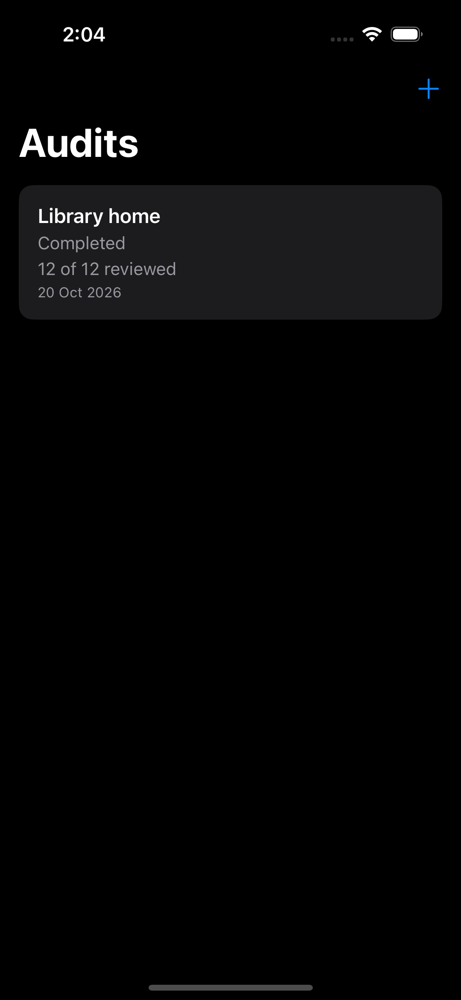
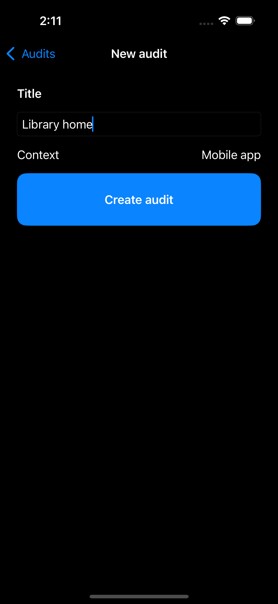
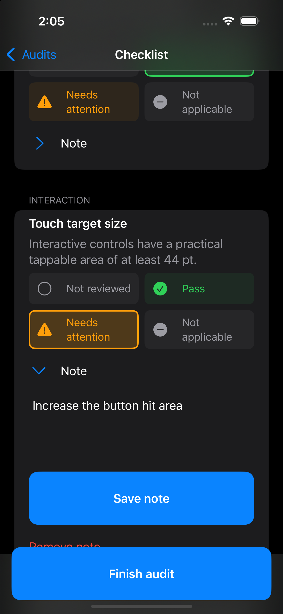
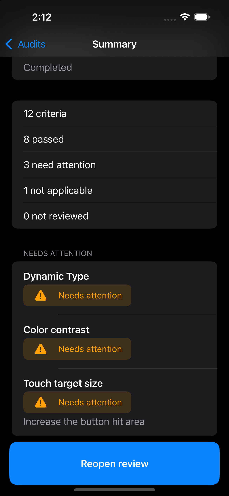

# Accessible Field Check

Structured accessibility review for mobile apps. Observations only — not a WCAG certification or legal compliance tool.

## Project overview

Accessible Field Check is an iOS app for recording a structured accessibility review of a mobile screen or flow. A reviewer names an audit, walks a fixed checklist, marks each criterion, and keeps an optional note. The summary lists counts and the items that need attention.

The app stores those observations on the device. It does not produce an accessibility score, certify conformance, or give legal advice.

## Problem being solved

Review notes in a generic document are easy to lose and hard to compare. This app keeps one local audit: a title, a stable set of criteria, a result for each criterion, and a short note where the reviewer needs one. The checklist is the same every time, so two reviews of the same kind of screen can be read the same way.

## Demo

Demo images are manual captures. There is no snapshot lane and no screenshot automation in this repository.









Sample content for a recapture:

- Audit title: `Library home`
- Note: `Increase the button hit area.` on the Touch target size criterion, marked Needs attention
- English localization

## Core features

- Create a draft audit with a required title. The review context in V1 is a mobile app.
- Start from a fixed catalog of 12 criteria in four groups: text and content, navigation, interaction, and feedback and errors.
- Set each item to Pass, Needs attention, Not applicable, or leave it Not reviewed.
- Add, edit, or remove one note per criterion.
- Finish the audit. If anything is still unreviewed, the app asks before completing it.
- Read a summary of counts and the needs-attention items, including their notes.
- Reopen a completed audit and continue the checklist.
- Keep audits in an on-device store. The list opens a draft on the checklist and a completed audit on the summary.

## Accessibility philosophy

Accessibility is a constraint on this app, not a later pass. The product is a review tool, so its own interface has to stay usable while someone is reviewing another interface.

Implemented decisions include:

- Dynamic Type through semantic text styles, including an accessibility-size layout that stacks result choices vertically instead of a grid.
- VoiceOver labels, hints, combined elements, and header traits on the main content.
- Selected-state traits on the active result and on an expanded note.
- Practical 44 point minimum targets on primary actions, result choices, and note controls.
- Icon and text together for each result. Color is not the only signal.
- Semantic colors for success, warning, critical text, and neutral states, including dark mode through system colors.
- Form validation that shows the empty-title message, focuses the field, and posts an announcement.
- Spanish and English strings in the string catalog.

These choices support a careful review. They are not a conformance claim.

## Architecture

The app is a SwiftUI interface over one local store.

`AppRootView` owns a single `NavigationStack` and a path of `AppDestination` values: `newAudit`, `checklist(UUID)`, and `summary(UUID)`. There is no tab bar.

Screens that show a live list use SwiftData `@Query`. Mutations go through a concrete `AuditStore` built with the environment `ModelContext`. `Audit` and `AuditItem` are `@Model` types. They are the domain values and the persisted records.

`AccessibilityCriterionCatalog` is a deterministic in-code catalog. It is not a SwiftData model. `AuditReviewProgress` is a pure value computed from results. It is not a view model, and it is not a score.

There is no view-model layer. The current flow is four screens over one store, and a view model would only forward the same calls. There is no repository or use-case abstraction, because nothing else reads or writes the store.

## Data model

Audits stay on the device. There is no sync and no backend.

**Audit**

| Concept | What is stored |
| --- | --- |
| id | `identifier`, a UUID |
| title | The reviewer-entered title |
| createdAt | Creation time |
| updatedAt | Last mutation time |
| status | `draft` or `completed`, stored as the raw value `statusRaw` |
| items | Related `AuditItem` records, deleted with the audit |

**AuditItem**

| Concept | What is stored |
| --- | --- |
| criterionID | Stable catalog id, such as `touchTargetSize` |
| result | `notReviewed`, `pass`, `needsAttention`, or `notApplicable`, stored as `resultRaw` |
| note | Optional text. Empty text is stored as no note |
| updatedAt | Last change to that item |

The catalog id is what persists. The title and guidance the reviewer sees come from the in-code catalog and `Localizable.xcstrings`. Changing a translation does not require rewriting stored audits.

## Navigation flow

```
Audits → New Audit → Checklist → Summary → Audits
```

- A draft opens the checklist.
- A completed audit opens the summary.
- Reopen on the summary returns that audit to draft and opens the checklist.
- Back from the summary returns to the audits list.

## Testing strategy

The suites that exist today are the suites CI runs. This change does not add product tests.

Unit tests use Swift Testing:

- Design-token tests check spacing, corner radius, and that each status has an icon and a text label.
- Catalog tests check the 12 stable ids, sort order, and that the catalog stores localization keys rather than display strings.
- `AuditReviewProgress` tests check the result tallies, including an empty list.
- `AuditStore` tests check create, result updates, note editing, complete and reopen, list order, unknown raw values, and a SwiftData round trip. Those tests use an in-memory `ModelContainer` and a new `ModelContext` to confirm the saved audit is still there.

UI tests use XCTest:

- `testHappyPathCreatesReviewFinishesAndPersistsAudit` creates an audit, sets results and a note, finishes, and returns to a non-empty list.
- `testEmptyTitleShowsValidationAndDoesNotCreateAudit` checks that a blank title stays on New Audit and does not add a row.

UI tests launch with `-ui-testing-empty-store`, which uses an in-memory SwiftData store so each run starts empty and does not touch the simulator's normal database.

`TEST_DESTINATION` selects the simulator. When it is unset, Fastlane uses `platform=iOS Simulator,name=iPhone 16,OS=18.2`.

Local validation of the lanes used:

`platform=iOS Simulator,name=iPhone 16,OS=18.2`

Hosted CI sets:

`platform=iOS Simulator,name=iPhone 17,OS=27.0`

Hosted GitHub Actions has not been observed. This repository has no git remote, so a green Actions run is not claimed here.

## CI/CD

The path is:

```
GitHub Actions → Bundler → Fastlane → xcodebuild
```

`.github/workflows/ci.yml` is the only workflow. It runs on push to `main` and on pull requests. The job uses the `xcode-27` runner, which is a GitHub public-preview image, and selects Xcode 27.0 build 27A266a. It does not fall back to another runner or Xcode. It installs the locked Bundler gems and runs `bundle exec fastlane ci`. No repository secret is required.

Fastlane lanes:

| Lane | What it does |
| --- | --- |
| `build` | Debug build for the generic iOS Simulator with `CODE_SIGNING_ALLOWED=NO` |
| `test` | Existing unit tests, then existing UI tests, on `TEST_DESTINATION` |
| `ci` | `build`, then `test` |

There is no signing automation, no certificate management, no TestFlight upload, and no App Store upload.

### Toolchains

Local and hosted toolchains differ.

| | Local development | Hosted workflow |
| --- | --- | --- |
| Xcode | 27.1, build 27A9275 | 27.0, build 27A266a, selected explicitly |
| Swift | 6.4 | The Swift that ships with that Xcode 27.0 |
| Destination used for tests | iPhone 16 / iOS 18.2 | iPhone 17 / iOS 27.0 |
| Deployment target | iOS 18.0 | iOS 18.0 |

### Release checklist

`v1.0.0` is a manual tag. This repository does not create it. Leave the version untagged while any item below is failed or not yet observed.

- Signing-free simulator build: passed locally through the `build` lane, including inside `ci`, on Xcode 27.1 build 27A9275.
- Unit tests: passed locally. 15 tests, 0 failures.
- UI tests: passed locally. 2 tests, 0 failures, on iPhone 16 / iOS 18.2. The `test` lane passed twice, then again inside `ci`.
- Fastlane `test`, `build`, and `ci`: passed locally on iPhone 16 / iOS 18.2.
- GitHub Actions: not yet observed. There is no git remote, so the hosted check has not run.
- OpenSpec change valid: `openspec validate ci-fastlane-and-public-release --strict` passed.
- Clean git status: not clean. The UI-test reliability fix is uncommitted. Required before tagging.
- README complete and demo images present: this document is in place, and the Demo section links the four `docs/demo/` PNGs.
- No secrets in the tree: none found in tracked text. Review again before tagging.

## Localization

The Xcode project development region is Spanish (`es`). `Localizable.xcstrings` uses Spanish as the source language and includes English translations. Known regions are English, Spanish, and Base. User-entered titles and notes are stored as typed. Criterion titles and guidance are localized through the catalog keys.

## Technology stack

- SwiftUI
- SwiftData
- NavigationStack
- String Catalog
- Swift Testing for unit tests
- XCTest for UI tests
- Fastlane, Bundler, and GitHub Actions for validation
- Deployment target iOS 18.0
- Marketing version 1.0

The Xcode project language mode is Swift 5 (`SWIFT_VERSION = 5.0`). The local compiler is Swift 6.4, from Xcode 27.1.

## Project structure

```
AccessibleFieldCheck/           App target
  AccessibleFieldCheckApp.swift SwiftData container and UI-test launch argument
  AppRootView.swift             NavigationStack and destinations
  AuditsView.swift              Audit list
  NewAuditView.swift            Title form
  AuditChecklistView.swift      Criterion review
  AuditSummaryView.swift        Counts and reopen
  AuditReviewProgress.swift     Pure progress value
  AFCAccessibilityID.swift      UI-test identifiers
  Localizable.xcstrings         Spanish source, English translations
  Domain/                       Audit, AuditItem, store, catalog
  DesignSystem/                 Tokens, primary button, status badge, empty state
AccessibleFieldCheckTests/      Swift Testing
AccessibleFieldCheckUITests/    XCTest flow
AccessibleFieldCheck.xcodeproj/
fastlane/Fastfile               test, build, ci
.github/workflows/ci.yml        Hosted check
docs/demo/                      Manual screenshots
```

## Engineering decisions

- One shared Xcode scheme is committed so a clean checkout can build and test. Personal `xcuserdata` stays ignored.
- Fastlane is the command both a laptop and GitHub Actions run. The workflow does not call a different `xcodebuild` script.
- `build` proves a signing-free generic simulator compile. `test` proves the suites. `ci` runs both.
- UI tests stay in that same required check. They are not a separate or optional job.
- The destination is an environment variable so local iPhone 16 / iOS 18.2 and hosted iPhone 17 / iOS 27.0 do not require two Fastfiles.
- Architecture stays in this README. There is no separate architecture document, because a second file would repeat this section.
- Screenshots are captured by hand. There is no snapshot lane.

## Non-goals

V1 does not include:

- An accessibility score or a WCAG conformance certificate
- Legal or regulatory compliance advice
- Export, photos, custom criteria, or team workflows
- A backend, sync, networking, or analytics
- AI or OCR
- TestFlight, App Store upload, or signing automation

## How to run

1. Open `AccessibleFieldCheck.xcodeproj`.
2. Select the `AccessibleFieldCheck` scheme.
3. Choose an iOS Simulator on iOS 18.0 or later. Local development currently uses Xcode 27.1.
4. Run.

The first screen is the audits list. With no saved audits, it shows the empty state and New Audit.

## How to run tests

Install the gems from `Gemfile.lock` with Bundler 4, then run a lane. The lockfile records Bundler 4.0.20.

```sh
bundle install
TEST_DESTINATION="platform=iOS Simulator,name=iPhone 16,OS=18.2" bundle exec fastlane test
```

`bundle exec fastlane ci` runs the signing-free build and then the same tests. `bundle exec fastlane build` compiles only.

Override `TEST_DESTINATION` to match a simulator that exists on the machine. The hosted workflow sets `platform=iOS Simulator,name=iPhone 17,OS=27.0`.

## Roadmap

Nothing in this list is a committed feature. Possible later work includes:

- Export of a finished review
- Richer audit history
- Custom criteria
- Team workflows
- Additional accessibility review contexts beyond a mobile app

## License

MIT. See [LICENSE](LICENSE). Copyright Nancy Hernandez.
